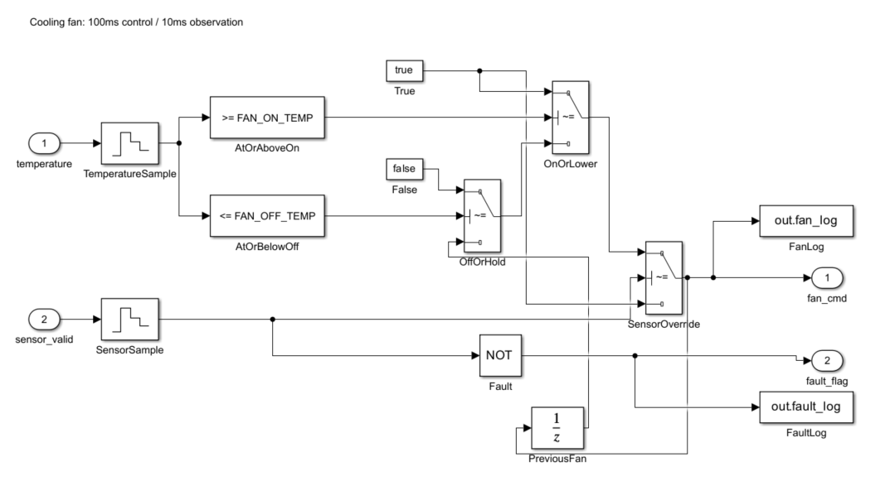

# Simulink 냉각팬 제어 모델 검증

냉각팬 제어기를 Simulink 블록으로 구현하고, 온도 경계값과 센서 오류·복구 조건에서 팬 명령이 요구사항대로 동작하는지 검증했습니다.

## 제어 로직과 검증 사례

센서가 정상이면 95℃ 이상에서 팬을 켜고, 90℃ 이하에서 끕니다. 두 임계값 사이에서는 직전 팬 명령을 유지해 온도가 임계값 부근에서 흔들려도 팬이 자주 켜졌다 꺼지지 않도록 했습니다. 센서 오류가 발생하면 온도와 관계없이 팬을 켜고 고장 신호를 출력합니다.

직접 구성한 모델에 `85 → 95 → 93 → 90℃`를 순서대로 입력했을 때 팬 명령은 `OFF → ON → ON → OFF`였습니다. 이후 센서 오류로 팬을 켠 상태에서 **복구 시점의 온도만 바꿔** 두 결과를 비교했습니다.

| 센서 복구 시점의 온도 | 실제 팬 명령 |
|---|---|
| 85℃ | OFF로 바뀜 |
| 93℃ | ON 유지 |

93℃에서 팬을 켠 상태로 유지하려면 **오류 처리까지 거친 최종 팬 명령**을 다음 주기에 전달해야 합니다. 모델에서는 마지막 `Switch`의 출력을 `Unit Delay`에 연결해 이 동작을 구현했습니다.



## 요구사항 기반 테스트

90℃와 95℃ 각각의 바로 아래, 경계값 자체, 바로 위를 검증 조건으로 정하고, 이를 포함한 테스트 케이스 생성을 Codex에 요청했습니다. 이전 상태 유지, 센서 오류·복구, 100ms 평가 주기 시나리오는 Codex와 함께 입력 순서와 기대 출력을 구체화했습니다.

예를 들어 90℃에서 팬이 **꺼지는지** 확인할 때는 먼저 팬을 켠 뒤 90℃를 입력했습니다. 이미 팬이 꺼져 있는 상태에서 90℃만 입력하면, 팬을 끄는 로직이 빠져 있어도 테스트가 통과할 수 있기 때문입니다.

기대 출력은 [요구사항](docs/02-requirements.md)에서 미리 정했습니다. MATLAB 스크립트로 모델을 실행하고, 각 시점의 팬 명령과 고장 표시를 Python에서 기대값과 비교했습니다. 저장소의 정상 모델은 **23개 테스트를 모두 통과**했습니다.

## 결함 주입과 검증 범위

정상 모델에서 통과한 테스트가 잘못된 동작도 검출하는지 확인하기 위해, 세 가지 결함을 각각 넣고 같은 테스트를 실행했습니다.

| 의도적으로 넣은 결함 | 테스트에서 확인한 결과 |
|---|---|
| 팬 ON 조건을 `>= 95`에서 `> 95`로 변경 | 95℃에서 팬이 켜지지 않음 |
| 오류 처리 전 팬 명령을 이전 상태로 저장 | 센서가 93℃에서 복구됐을 때 팬이 꺼짐 |
| 센서 오류 시 강제 ON 제거 | 저온에서 센서 오류가 나도 팬이 켜지지 않음 |

모델의 초기값, 샘플 시간, 최종 팬 명령의 연결도 별도로 점검했습니다. 검증 범위는 제어 모델의 출력으로, 실제 냉각 성능이나 ECU 동작은 다루지 않았습니다. **모델 구조 커버리지는 측정하지 않았으므로**, 23개 통과는 실행한 시나리오에서 기대한 동작을 확인한 결과입니다.

## 실행과 결과 확인

자동 검증은 MATLAB R2023a의 Simulink와 Python 3.11에서 실행했습니다. 저장소 루트에서 아래 명령으로 정상 모델의 검증 결과를 재현할 수 있습니다.

```text
matlab -batch "addpath('scripts/matlab'); check_model; run_tests;"
python scripts/python/check_results.py
```

- [테스트 입력과 기대값](docs/05-test-specification.md)
- [요구사항과 테스트 연결](docs/06-traceability.md)
- [자동 검증 결과](results/actual/summary.csv) · [결함 주입 결과](results/mutation-summary.md) · [전체 검증 보고서](docs/07-verification-report.md)
