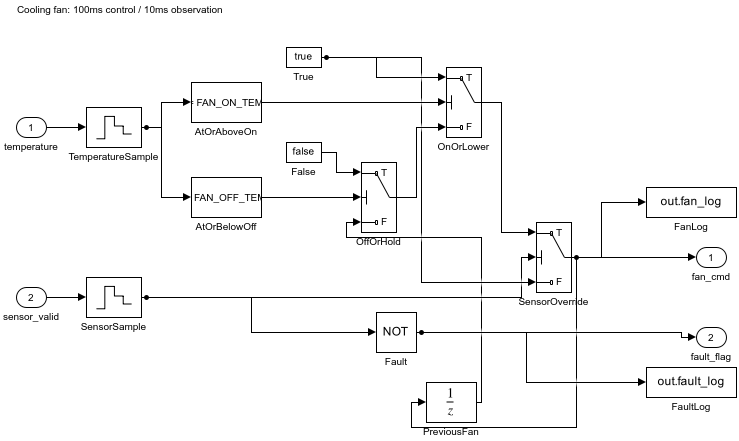

# CoolingFan-Controller

## Simulink ��� �ð��� ���� �� ���� �� �׽�Ʈ �ڵ�ȭ

�µ������� ���¿� ���� �� ������ �����ϴ� �⺻ ���� �𵨰� �䱸���� ��� ���� ������Ʈ�Դϴ�. ���� ���� 23�� ���� �׽�Ʈ�� �����ϰ�, 3���� �ǵ��� ������ �׽�Ʈ�� �����߽��ϴ�.

## ���� ��Ģ

| ���� | �� ���� | ���� ǥ�� |
|---|---|---|
| ���� ���� | ON | ON |
| ����95�� �̻� | ON | OFF |
| ����90�� ���� | OFF | OFF |
| ����90�� �ʰ� 95�� �̸� | ���� ���� ���� | OFF |

�� �ʱ� ���´� OFF�Դϴ�. �ʱ�ȭ �� t=0���� ù �򰡸� �����ϰ� ���� 100ms���� �����մϴ�. ���� ó������ ���� ���� ������ �����ϹǷ� 93�ɿ��� ������ �����Ǹ� �� ON�� �����մϴ�.

## �� ����



| ���� | ���� ���� |
|---|---|
| Zero-Order Hold | �Է��� 100ms���� ���ø� |
| Compare To Constant | 95�� �̻�, 90�� ���� ��� ���� |
| Switch | �µ� ������ ���� ���� �켱���� ���� |
| Unit Delay | ���� �� ���¸� �� ���� �ֱ� ���� |
| NOT | ���� ���� ���θ� ���� ǥ�÷� ��ȯ |

## ����

1. [������Ʈ ��ȹ��](docs/01-project-plan.md)
2. [�䱸���� ���Ǽ�](docs/02-requirements.md)
3. [���� ��ȹ��](docs/03-verification-plan.md)
4. [�� ���輭](docs/04-model-design.md)
5. [23�� �׽�Ʈ ����](docs/05-test-specification.md)
6. [�䱸���� ������](docs/06-traceability.md)
7. [���� ��� ������](docs/07-verification-report.md)

## ���� ȯ��

- ���� ȯ��: MATLAB R2023a Update 8, Simulink, Python 3.11
- Python�� ǥ�� ���̺귯���� ����մϴ�. pip ��ġ�� �ʿ����� �ʽ��ϴ�.
- Simulink Test, Coverage, Check, Stateflow, Coder�� ���� �ʼ� ��ǰ�� �ƴմϴ�.
- ����� ��Ʈ���� �Ʒ� ������ �����մϴ�. MATLAB ��ġ ������ PATH�� matlab�� ��ϵǾ� �־�� �մϴ�.

### 1. �׽�Ʈ ������ �غ�

```text
python scripts/python/prepare_tests.py
python scripts/python/write_test_docs.py
```

��� ����� �䱸���׿��� ���� ������ �̺�Ʈ ǥ�� Ȯ���� ���Դϴ�. �� ����̳� ���� ���� �˰��������� ��밪�� �������� �ʽ��ϴ�.

### 2. �� ���� �˻�� ���� �� ����

```text
matlab -batch "addpath('scripts/matlab'); check_model; run_tests;"
python scripts/python/check_results.py
```

`models/cooling_fan.slx`�� ���� ���� Ȯ���� �� �ֽ��ϴ�. ������ ������ build_model.m�� �⺻ �������� �����մϴ�. ���� ������ ������ ���� ���� ������ �����ϱ� ���� ��������� �ʰ� �ҷ��ɴϴ�. �� ���� �ڵ带 ������ ��� ���� �𵨰� ���Ͽ� �����ؾ� �մϴ�.

���� 100ms �ֱ�� �����ϰ� �׽�Ʈ ����� 10ms �������� �����մϴ�. ����� `results/actual/`�� ����˴ϴ�. �� ���� ���� �� �ش� ���� ������ ���� �׽�Ʈ CSV�� �����Ͽ� ������ ����� ������� �ʵ��� �մϴ�.

### 3. �ǵ��� ���� ����

```text
matlab -batch "addpath('scripts/matlab'); run_tests('on_strict'); run_tests('wrong_feedback'); run_tests('no_override');"
python scripts/python/check_mutations.py
```

������ �޸𸮿����� �����ϸ� ���� .slx ���Ͽ� �������� �ʽ��ϴ�. ���� ���� �Ϻ� �׽�Ʈ�� FAIL�� ���� ���� ����Դϴ�. check_mutations.py�� ������ �׽�Ʈ���� ���� �� ��� ����ġ�� �����ϸ� ���� �ڵ� 0�� ��ȯ�մϴ�.

### 4. ���� ���� �˻�� ���� ���� ���

```text
python -m unittest discover -s tests -p test_result_checker.py
python scripts/python/record_run.py
```

�ҽ����𵨡��Է¡���밪�� ����� SHA-256�� `results/reproducibility.json`�� ����մϴ�. ���� �� MATLAB/Simulink ��ǰ ������ UTC �ð��� ������ ����ϴ�.

## ����

| ��� | ���� |
|---|---|
| docs/ | ������ �䱸����, ����, ���� ���� |
| models/ | Simulink �� |
| scripts/matlab/ | �� ����, ���� �˻�, �ùķ��̼� |
| scripts/python/ | �Է¡����� ����, ��� ����, ���� ���� Ȯ�� |
| tests/ | ���� �׽�Ʈ 23��, ��밪, ���� ���� �׽�Ʈ |
| results/ | ���� ���, ���, ȯ��, ���� �̹��� |

## ������ �Ѱ�

���� �ð� ���ɡ�ECU������ ������ �������� �ʽ��ϴ�. �µ� ���� ��ȿ���� �ܺ� �Է� ����̸�, ������ ������ �� ��ȿ�� ���� �Ǽ��� �����Ѵٰ� �����մϴ�. �� ���̿� �߻��ߴٰ� ������� ������ ������� �ʽ��ϴ�.

�� ���� �˻�� ���� ���並 ���� �ٰŷ� ����߽��ϴ�. MISRA �˻�, ���� ����, �� ���� Ŀ������ ������ �������� �ʾҽ��ϴ�. ����� ISO 26262 �����̳� MISRA �ؼ��� �ǹ����� �ʽ��ϴ�.

�ʱ� ���� ǥ�� OFF�� ù �� ���� ������ �ʱ� �����̸� ��� ���÷� ���� ������� �ʽ��ϴ�. REQ-001�� �ٰſ� ���� �׽�Ʈ ����� �����Ͽ� [��� ������](docs/07-verification-report.md)�� ����մϴ�.
